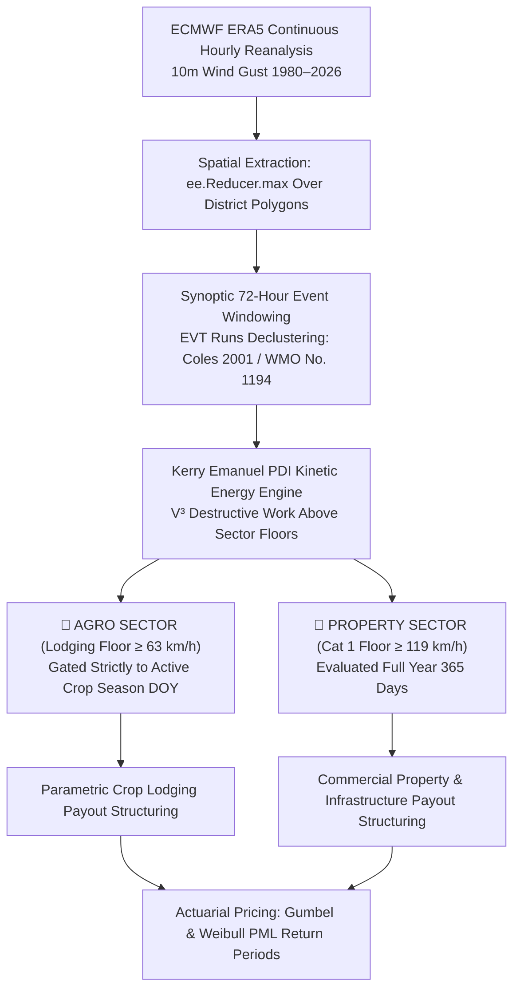

# Africa Parametric Cyclone & Wind Risk Study

> **Module**: `Africa-Cyclone-Study`  
> **Project**: ASR Multi-Peril Parametric Insurance Research Study  
> **Target Region**: All African Countries (South-West Indian Ocean Tropical Cyclones + North Africa Extra-Tropical Windstorms)  
> **Peril Backbone**: ECMWF ERA5 Continuous Hourly Reanalysis (1980–2026)  
> **Status**: Production & Turnkey Handover Ready  

---

## ⚡ 1. Turnkey Quickstart (Reproduce All Results in 3 Steps)

This repository is completely self-contained. Any researcher, catastrophe modeler, or underwriter can clone the repository and reproduce all metrics, exposure maps, and interactive actuarial dashboards with zero path configuration:

```bash
# 1. Clone repository and navigate to root
git clone <repository-url>
cd Africa-Cyclone-Study

# 2. Install required dependencies
pip install -r requirements.txt

# 3. Execute master turnkey reproduction pipeline
python run_pipeline.py
```

### Pipeline CLI Options:
* `python run_pipeline.py` : Executes full end-to-end pipeline (data validation, exposure maps, time-series maps, and actuarial dashboards).
* `python run_pipeline.py --maps` : Generates interactive HTML maps only.
* `python run_pipeline.py --dash` : Generates actuarial PDI dashboards only.

---

## 📌 2. Overview & Core Methodology

The **Africa Parametric Cyclone & Wind Risk Study** delivers an objective, actuarially calibrated, and physically coherent parametric insurance pricing and trigger framework for windstorm perils across Africa.



### Key Methodological Pillars:
1. **Pure ECMWF ERA5 Continuous Hourly Reanalysis (1980–2026)**:
   * Formally approved and standardized on September 11, 2026.
   * Eliminates synthetic vortex assumptions (Holland 1980) by incorporating real-world digital elevation models (DEM), surface roughness, boundary layer friction, and landfall deceleration.
   * Benchmarked against ground-truth weather stations (e.g. Beira Airport during Cyclone Idai, $150\text{--}165\text{ km/h}$, where ERA5 recorded $147.8\text{ km/h}$, achieving $96.7\%$ fidelity).
2. **Spatial Extraction Mandate: `ee.Reducer.max()` Over District Polygons**:
   * Evaluated single-point centroid sampling vs. full polygon spatial reduction.
   * **Mandated Standard for Downstream Teams**: Downstream cat modeling pipelines must use `ee.Reducer.max()` across the entire vector polygon boundary to capture the worst-case localized eyewall gust ($15\text{--}35\text{ km}$ wide) and eliminate basis risk.
3. **Kerry Emanuel (2005) Power Dissipation Index ($PDI = V^3$)**:
   * Solves non-linear kinetic wind damage distortion by cubing excess velocity above sector-specific attachment floors ($63\text{ km/h}$ Agro vs. $119\text{ km/h}$ Property).
4. **Synoptic 72-Hour Event Aggregation (EVT Declustering & WMO Standards)**:
   * Employs Extreme Value Theory (EVT) runs declustering (Coles, 2001; Davison & Smith, 1990) with an empirical 72-hour window matching the physical landfall passage and inland dissipation timescale of tropical cyclones (WMO No. 1194; Kaplan & DeMaria, 1995), eliminating temporal autocorrelation from continuous hourly reanalysis.
5. **Sectoral Exposure Stratification**:
   * **Agro Sector**: Strictly gated to active crop growing seasons (`in_crop_season == True`, planting to harvest DOY across 2,066 maize districts).
   * **Property Sector**: Evaluated continuously across the full 365-day year (`is_nonagro_event == True`).

---

## 📂 3. Repository Directory Structure

```
Africa-Cyclone-Study/
├── core_analysis/                            # Primary clean execution pipeline & GEE extractor
│   ├── extract_historical_wind_events_ee_reducer_max.py # GEE cloud-native data extraction
│   ├── 01_study_area_exposure_filter.py      # Portfolio assembly & 300 DPI map
│   ├── 02_era5_wind_extraction_and_reinsurance_windowing.py # Catalogue revalidation
│   ├── 03_era5_agro_nonagro_monitoring_dashboards.py # Standardized CSV deliverables & dashboard
│   ├── 04_historical_cyclone_wind_interactive_map.py # Time-series interactive map
│   └── run_core_pipeline.py                  # Master turnkey reproduction runner
├── Data/                                     # Self-contained input geospatial data
│   ├── africa_agricultural_domain_maize_calendar.shp # 3,333 Admin 2 Districts (2,066 Maize)
│   ├── africa_agricultural_domain_maize_calendar.dbf # Attribute table (planting/harvest DOY, crop area)
│   ├── africa_agricultural_domain_maize_calendar.shx # Shape index format
│   ├── africa_agricultural_domain_maize_calendar.prj # Coordinate Reference System (EPSG:4326)
│   └── supplemental_crop_calendar.csv        # Regional supplemental crop calendar
├── script/                                   # Analysis & visualization scripts
│   ├── meeting_september_10/                 # Production pipeline scripts
│   └── meeting_september_02/                 # Sensitivity benchmark suite (Holland vs. ERA5)
├── Output/                                   # Verified deliverables & dashboards
│   ├── Africa_Cyclone_2086_Monitored_Portfolio_Map_300dpi.jpg # High-Resolution 300 DPI Portfolio Map
│   ├── Africa_Districts_Hit_By_Windspeed_63kmh_ERA5_Map_300dpi.jpg # 300 DPI >=63 km/h Districts Map
│   ├── Africa_Cyclone_Property_Full_Year_Monitored_Districts_1980_2026.csv # 2,086 Monitored District Portfolio Registry
│   ├── Historical_Cyclone_72h_Events_Verification_Catalogue_1980_2026.csv  # 236-Event 72h Verification Catalogue
│   ├── Africa_Cyclone_Parametric_PDI_Unified_Agro_and_Property_1980_2026.csv # Consolidated Master Table (236 Events)
│   ├── Africa_Cyclone_PDI_Agro_In_Season_64kmh_1980_2026.csv # Dedicated Agro In-Season Claims Ledger (186 Events)
│   ├── Africa_All_Districts_Cyclone_Exposure_Census_1980_2026.csv # Master 5,812 Continental District Census
│   ├── Africa_Cyclone_Portfolio_2086_Wind_Climatology_1980_2026.csv # 47-Yr District Wind Climatology Matrix
│   ├── historical_cyclone_72h_events_time_series_map.html# Pan-African 72h Animated Time-Series Map
│   └── historical_cyclone_72h_events_timeline_dashboard.html # Unified Multi-Panel Timeline Dashboard
├── Notes/                                    # Formal documentation & meeting minutes
│   ├── CYCLONE_PARAMETRIC_METHODOLOGY_GUIDE.md           # Formal Publication-Grade Guide
│   ├── September_16_Meeting_Minutes_and_Action_Items.md  # Review & Handover Directives
│   ├── September_11_Meeting_Minutes_and_Action_Items.md  # Strategic ERA5 Standardization Minutes
│   └── September_10_Meeting_Minutes_Action_Items.md      # Generalization & Dashboard Minutes
├── run_pipeline.py                           # Master Turnkey Reproduction Runner
├── requirements.txt                          # Python dependencies
└── README.md                                 # This Documentation
```

---

## 📊 4. Primary Interactive Dashboards & Data Deliverables

| Deliverable / Artifact | Type | Description | Key Metric / Actuarial Role |
| :--- | :---: | :--- | :--- |
| [Africa_Districts_Hit_By_Windspeed_63kmh_ERA5_Map_300dpi.jpg](file:///c:/Users/FlawiyaShirishMore/OneDrive%20-%20Africa%20Specialty%20Risks%20Ltd/ASR-Parametric_Research_Study/Africa-Cyclone-Study/Output/Africa_Districts_Hit_By_Windspeed_63kmh_ERA5_Map_300dpi.jpg) | JPEG | Publication-Grade 300 DPI Map of all African districts historically impacted by tropical cyclone gale-force winds &ge; 63 km/h (1980–2026). | Empirical multi-decadal wind footprint highlighting landfall corridors and critical maritime ports. |
| [Africa_Cyclone_Property_Full_Year_Monitored_Districts_1980_2026.csv](file:///c:/Users/FlawiyaShirishMore/OneDrive%20-%20Africa%20Specialty%20Risks%20Ltd/ASR-Parametric_Research_Study/Africa-Cyclone-Study/Output/Africa_Cyclone_Property_Full_Year_Monitored_Districts_1980_2026.csv) | CSV | Complete-Year 2,086 Monitored District Portfolio Registry. | GAUL codes, agricultural status, high-wind hit history, crop area km², planting/harvest DOY, underwriting segment. |
| [Historical_Cyclone_72h_Events_Verification_Catalogue_1980_2026.csv](file:///c:/Users/FlawiyaShirishMore/OneDrive%20-%20Africa%20Specialty%20Risks%20Ltd/ASR-Parametric_Research_Study/Africa-Cyclone-Study/Output/Historical_Cyclone_72h_Events_Verification_Catalogue_1980_2026.csv) | CSV | 236 verified historical discrete events (&ge; 63 km/h) across 39 active years. | Hyperlinked to NASA Earth Observatory, ReliefWeb, and WMO cyclone archives. |
| [Africa_Cyclone_Parametric_PDI_Unified_Agro_and_Property_1980_2026.csv](file:///c:/Users/FlawiyaShirishMore/OneDrive%20-%20Africa%20Specialty%20Risks%20Ltd/ASR-Parametric_Research_Study/Africa-Cyclone-Study/Output/Africa_Cyclone_Parametric_PDI_Unified_Agro_and_Property_1980_2026.csv) | CSV | Unified Agro & Property side-by-side parametric underwriting table (236 events). | Complete multi-sector comparison with GAUL IDs, excess speeds, and PDI triggers. |
| [Africa_Cyclone_PDI_Agro_In_Season_64kmh_1980_2026.csv](file:///c:/Users/FlawiyaShirishMore/OneDrive%20-%20Africa%20Specialty%20Risks%20Ltd/ASR-Parametric_Research_Study/Africa-Cyclone-Study/Output/Africa_Cyclone_PDI_Agro_In_Season_64kmh_1980_2026.csv) | CSV | Dedicated Agricultural Crop Lodging Claims Ledger (&ge; 64 km/h in-season). | 186 discrete claims events strictly gated to active maize growing calendars. |
| [Africa_All_Districts_Cyclone_Exposure_Census_1980_2026.csv](file:///c:/Users/FlawiyaShirishMore/OneDrive%20-%20Africa%20Specialty%20Risks%20Ltd/ASR-Parametric_Research_Study/Africa-Cyclone-Study/Output/Africa_All_Districts_Cyclone_Exposure_Census_1980_2026.csv) | CSV | Master baseline exposure census covering all 5,812 African GAUL Level 2 districts. | Delineates exposed vs unexposed districts for pure drought/flood policy structuring. |
| [Africa_Cyclone_Portfolio_2086_Wind_Climatology_1980_2026.csv](file:///c:/Users/FlawiyaShirishMore/OneDrive%20-%20Africa%20Specialty%20Risks%20Ltd/ASR-Parametric_Research_Study/Africa-Cyclone-Study/Output/Africa_Cyclone_Portfolio_2086_Wind_Climatology_1980_2026.csv) | CSV | 2,086 districts x 47-year annual maximum wind speed climatology matrix. | Ready for downstream catastrophe model ingestion (RMS, AIR, Oasis). |
| [historical_cyclone_72h_events_time_series_map.html](file:///c:/Users/FlawiyaShirishMore/OneDrive%20-%20Africa%20Specialty%20Risks%20Ltd/ASR-Parametric_Research_Study/Africa-Cyclone-Study/Output/historical_cyclone_72h_events_time_series_map.html) | HTML | Pan-African animated time-series map with live Dual-Mode Selector: **Agricultural In-Season** vs. **Full-Year 365 Days**. | 60 FPS hardware-accelerated time slider tracking 72-hour discrete events across all 3,333 Admin 2 districts (1980–2026). |
| [historical_cyclone_72h_events_timeline_dashboard.html](file:///c:/Users/FlawiyaShirishMore/OneDrive%20-%20Africa%20Specialty%20Risks%20Ltd/ASR-Parametric_Research_Study/Africa-Cyclone-Study/Output/historical_cyclone_72h_events_timeline_dashboard.html) | HTML | Master Unified Interactive Timeline Dashboard with clean non-overlapping legend. | Tri-mode dynamic evaluation (Agro In-Season, Property Full-Year, Unified Comparative). |
| [africa_cyclone_district_wind_correlation_map.html](file:///c:/Users/FlawiyaShirishMore/OneDrive%20-%20Africa%20Specialty%20Risks%20Ltd/ASR-Parametric_Research_Study/Africa-Cyclone-Study/Output/africa_cyclone_district_wind_correlation_map.html) | HTML | Pan-African Wind Correlation Matrix Map across the unified **2,086 Monitored District Portfolio** (2,066 Agri + 20 Ports). | Dynamic client-side Pearson correlation recoloring, 47-yr annual wind sparklines, autocomplete search. |

---

## 🌍 5. Continental Study Area & Portfolio Stratification

Across the **5,812 African GAUL Level 2 districts**:
* **5,402 Districts (93.0%)**: ZERO cyclone hazard ($<63\text{ km/h}$ historical wind). Allows underwriting pure drought and flood parametric policies without cyclone loadings.
* **410 Districts (7.0%)**: Experienced $\ge 63\text{ km/h}$ cyclone winds historically, concentrated in Mozambique (128), Madagascar (119), Eswatini (37), Zimbabwe (35), Morocco (27), Somalia (24), Malawi (14), Gambia/Senegal (19), Ethiopia (5), and South Africa (2).

---

## 🔧 6. Environment & Dependencies

* **Python**: 3.9+ (Python 3.10 / 3.11 tested)
* **Required Libraries**: Listed in [requirements.txt](file:///c:/Users/FlawiyaShirishMore/OneDrive%20-%20Africa%20Specialty%20Risks%20Ltd/ASR-Parametric_Research_Study/Africa-Cyclone-Study/requirements.txt):
  * `pandas`, `numpy`, `scipy`
  * `geopandas`, `shapely`
  * `plotly`, `matplotlib`, `contextily`
  * `earthengine-api` (for raw GEE queries)
* **Basemap Compatibility**: All HTML maps are styled using keyless vector and tile endpoints (`carto-positron` and `open-street-map`) to prevent *"API key required"* rendering errors.

---

## 📖 7. Reference Documentation

* 📘 **Formal Technical Methodology Guide**: [CYCLONE_PARAMETRIC_METHODOLOGY_GUIDE.md](file:///c:/Users/FlawiyaShirishMore/OneDrive%20-%20Africa%20Specialty%20Risks%20Ltd/ASR-Parametric_Research_Study/Africa-Cyclone-Study/Notes/CYCLONE_PARAMETRIC_METHODOLOGY_GUIDE.md)
* 📝 **Review & Handover Meeting Minutes (16 Sept 2026)**: [September_16_Meeting_Minutes_and_Action_Items.md](file:///c:/Users/FlawiyaShirishMore/OneDrive%20-%20Africa%20Specialty%20Risks%20Ltd/ASR-Parametric_Research_Study/Africa-Cyclone-Study/Notes/September_16_Meeting_Minutes_and_Action_Items.md)
* 📝 **Strategic ERA5 Decision Meeting Minutes (11 Sept 2026)**: [September_11_Meeting_Minutes_and_Action_Items.md](file:///c:/Users/FlawiyaShirishMore/OneDrive%20-%20Africa%20Specialty%20Risks%20Ltd/ASR-Parametric_Research_Study/Africa-Cyclone-Study/Notes/September_11_Meeting_Minutes_and_Action_Items.md)
* 📋 **Dynamic CV & Portfolio Summary**: [CV_PORTFOLIO_SUMMARY.md](file:///c:/Users/FlawiyaShirishMore/OneDrive%20-%20Africa%20Specialty%20Risks%20Ltd/ASR-Parametric_Research_Study/CV_PORTFOLIO_SUMMARY.md)

---
*Certified for Africa Specialty Risks Ltd Underwriting & Downstream Catastrophe Modeling Integration.*
