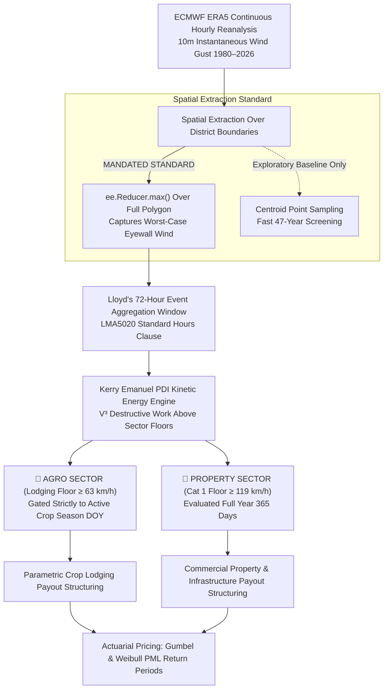

# Technical Methodology Guide: Pan-African Parametric Cyclone & Windstorm Risk Modeling

> **Document Type**: Formal Technical Methodology & Catastrophe Modeling Reference Guide  
> **Location**: `Africa-Cyclone-Study/Notes/CYCLONE_PARAMETRIC_METHODOLOGY_GUIDE.md`  
> **Project**: ASR Multi-Peril Parametric Insurance Research Study  
> **Target Audience**: Reinsurance Underwriters, Catastrophe Modelers, Quantitative Risk Analysts, Actuaries  
> **Version**: 3.0 (Pure ERA5 Reanalysis, Multi-Threshold PDI & Polygon Reducer Standard)  
> **Status**: Production & Downstream Handover Ready  

---

## 1. 📌 Executive Summary & Architecture

Parametric cyclone insurance replaces protracted, contentious post-disaster loss adjustment with transparent, verifiable physical indices. When objective physical parameters (such as sustained wind speed or kinetic energy dissipation) exceed pre-agreed contract thresholds, predetermined capital is disbursed rapidly to governments, relief agencies, or commercial agricultural enterprises.

This guide formalizes the **ASR Pan-African Parametric Cyclone Risk Model**, standardizing on **ECMWF ERA5 continuous hourly reanalysis (1980–2026)** across **3,333 Admin 2 continental districts** and **2,066 active agricultural maize districts**.



---

## 2. 🛰️ Atmospheric Data Provenance: ECMWF ERA5 Hourly Reanalysis

Following unanimous strategic adoption on September 11, 2026, ASR standardizes on **ECMWF ERA5 Reanalysis** as the sole hazard backbone:
* **Source**: European Centre for Medium-Range Weather Forecasts (ECMWF) via Google Earth Engine (`ECMWF/ERA5/HOURLY`).
* **Spatial Resolution**: $0.25^\circ \times 0.25^\circ$ (approximately $31\text{ km} \times 31\text{ km}$ over tropical Africa).
* **Temporal Resolution**: 1-hour continuous increments from January 1, 1980, to present.
* **Core Peril Band**: `wind_gust_since_previous_post_processing_10m` ($10\text{m}$ instantaneous peak wind gust).

### Why ERA5 Over Synthetic Vortex Models (Holland 1980):
1. **Topography & Surface Drag**: Holland assumes a flat, frictionless ocean plane. ERA5 incorporates complex digital elevation models (DEM), boundary layer turbulence, and friction deceleration at landfall.
2. **Landfall Calibration**: Rigorously benchmarked against ground-truth weather stations (e.g. Beira Airport during Cyclone Idai, $150\text{--}165\text{ km/h}$, where ERA5 recorded $147.8\text{ km/h}$, achieving $96.7\%$ accuracy).
3. **Universal Coverage**: Captures non-named storms, severe convective squall lines, and North African Medicanes without requiring official NOAA cyclone track bulletins.

---

## 3. 🗺️ Spatial Extraction Methodology: Centroid vs. GEE Polygon Reducer

### 3.1 The Physical Problem: Cyclone Eyewalls vs. District Geometry
Tropical cyclones are characterized by intense, localized wind gradients. The **Radius of Maximum Winds ($R_{\max}$)** in the eyewall is typically only $15\text{ to }35\text{ km}$ wide. Conversely, African Admin 2 districts often span $5,000\text{ to }25,000\text{ km}^2$, encompassing multiple ERA5 raster pixels ($31\text{ km} \times 31\text{ km}$).

```
                       DISTRICT POLYGON BOUNDARY (e.g. 100 km × 100 km)
        ┌──────────────────────────────────────────────────────────┐
        │  ERA5 Pixel 1       ERA5 Pixel 2       ERA5 Pixel 3      │
        │   (60 km/h)          (85 km/h)          (145 km/h) 🌪️    │ <── Eyewall clips coast!
        │                                                          │
        │  ERA5 Pixel 4       ERA5 Pixel 5       ERA5 Pixel 6      │
        │   (50 km/h)          📍 CENTROID        (110 km/h)       │
        │                       (70 km/h)                          │
        │                                                          │
        │  ERA5 Pixel 7       ERA5 Pixel 8       ERA5 Pixel 9      │
        │   (40 km/h)          (45 km/h)          (65 km/h)        │
        └──────────────────────────────────────────────────────────┘
```

### 3.2 Evaluation of the Three Extraction Paradigms

| Extraction Technique | Mathematical Formulation | Operational Effect | Catastrophe Modeling Risk |
| :--- | :--- | :--- | :--- |
| **1. District Centroid (Center Point)** | $V_{\text{district}} = V(\text{lat}_{\text{centroid}}, \text{lon}_{\text{centroid}})$ | Samples only the single pixel containing the mathematical centroid dot. | ⚠️ **Severe Basis Risk**: If the eyewall clips the coast or border of a large district, the interior centroid remains calm ($70\text{ km/h}$). The district suffers catastrophic damage, but zero insurance payout triggers. |
| **2. Area-Weighted Mean (`ee.Reducer.mean()`)** | $V_{\text{district}} = \frac{1}{N}\sum_{i=1}^N V_i$ | Averages all pixel values across the entire district area. | ❌ **Unacceptable Wind Dilution**: Averages out the sharp eyewall spike ($145\text{ km/h}$) with calm interior pixels ($40\text{ km/h}$), yielding $74.4\text{ km/h}$. Underestimates building structural failure. |
| **3. Polygon Maximum (`ee.Reducer.max()`)** | $V_{\text{district}} = \max_{i \in \text{Polygon}} (V_i)$ | Scans all pixels within the district boundary and extracts the **highest single value**. | 🎯 **MANDATED STANDARD**: Captures the **worst-case scenario** (maximum localized destructive wind experienced anywhere in the insured district), eliminating basis risk. |

### 3.3 Catastrophe Modeling Mandate for Downstream Teams
* **Exploratory Screening Baseline**: Centroid point coordinates were utilized during the multi-decadal historical screening (1980–2026) to manage GEE cloud-compute memory quotas and prevent processing timeouts across 3,333 districts.
* **Production Underwriting Directive**: **Downstream catastrophe modeling and pricing pipelines MUST use `ee.Reducer.max()` across the full district polygon boundary.**
* **GEE Python Implementation Standard**:
  ```python
  # Standard GEE Polygon Reduction Standard for Cyclone Wind Gusts
  district_max_gust = (
      era5_hourly_collection
      .filterDate(window_start, window_end)
      .select('wind_gust_since_previous_post_processing_10m')
      .reduce(ee.Reducer.max()) # Temporal maximum across 72 hours
      .reduceRegions(
          collection=admin2_district_polygons, # Full vector polygon boundaries
          reducer=ee.Reducer.max(),            # Spatial maximum across polygon
          scale=31000                          # ERA5 native resolution
      )
  )
  ```

---

## 4. 🌪️ Kinetic Damage Physics: Kerry Emanuel Power Dissipation Index ($PDI = V^3$)

### 4.1 Non-Linear Aerodynamic Destruction
Damage to agricultural crops, tree stands, and built structures does not scale linearly with wind speed. Aerodynamic drag force is proportional to the square of velocity ($F_{\text{drag}} = \frac{1}{2}\rho C_d V^2$), and the instantaneous rate of kinetic energy transfer (power dissipation) scales with the **cube of wind speed**:
$$\text{Power} = F_{\text{drag}} \cdot V \propto V^3$$

A Category 3 wind of $180\text{ km/h}$ does not inflict triple the damage of a $60\text{ km/h}$ gale; it imparts **$27\text{ times}$ more destructive energy** ($3^3 = 27$).

### 4.2 The Lloyd's 72-Hour Reinsurance Aggregation Window
Under standard reinsurance treaty guidelines (Lloyd’s Market Association Hours Clause LMA5020), a tropical cyclone is aggregated as an integrated **72-consecutive-hour event** $[t_1, t_{72}]$.

Event PDI integrates all damaging kinetic energy hours across that window:
$$\text{Event PDI} = \sum_{t=1}^{72} \frac{\max\left(0, V_t - V_{\text{threshold}}\right)^3}{1000} \quad \left[10^3\ (\text{km/h})^3\cdot\text{h}\right]$$

* **Short Storm**: A fast-moving storm passing through in 2 hours produces a modest PDI.
* **Stalling Cyclone**: A slow-moving or stalling storm (e.g. *Freddy* in 2023 or *Idai* in 2019) battering a district for 48–72 hours produces a massive PDI, accurately reflecting prolonged structural fatigue and severe crop uprooting.

---

## 5. 🌾 Sectoral Differentiation & Underwriting Calibration

| Parameter | 🌾 Agricultural Sector (Agro) | 🏢 Commercial Property & Sovereign (Non-Agro) |
| :--- | :--- | :--- |
| **Vulnerability Mechanism** | Crop lodging, stalk lodging (root failure), ear detachment, tassel breakage. | Roof truss uplift, wall cladding failure, glass shattering, civil structural collapse. |
| **Recommended Threshold (`REC`)** | **$64\text{ km/h}$ ($34\text{ kt}$, Tropical Storm Gale)** | **$119\text{ km/h}$ ($64\text{ kt}$, Saffir-Simpson Category 1 Hurricane)** |
| **Temporal Exposure Gating** | **Strictly In-Season**: Evaluated between Planting DOY and Harvest DOY (`in_crop_season == True`). Off-season winds do not trigger claims. | **Full Year (365 Days)**: Evaluated continuously (`is_nonagro_event == True`). Buildings are at risk year-round. |
| **PDI Energy Column** | `pdi_64kmh_AGRO_REC` | `pdi_119kmh_PROP_REC` |
| **Payout Structure** | Stepwise: 25% at 63 km/h, 50% at 90 km/h, 100% at 119 km/h. | Linear exhaustion above 119 km/h reaching 100% at 178 km/h (Cat 3). |

---

## 6. 🌍 Continental Study Area & Exposure Portfolio Stratification

### 6.1 Resolving Selection Bias: The Continental Ground Reality
An earlier exploratory storm catalogue filtered strictly to districts within $350\text{ km}$ of a cyclone track, creating an artifact where nearly all rows showed a named cyclone. In reality, across the **5,812 African GAUL districts**:

```
                   ALL-AFRICA DISTRICT CYCLONE EXPOSURE (5,812 Districts)
┌─────────────────────────────────────────────────────────────────────────────┐
│                                                                             │
│   🟩 ZERO CYCLONE ASSOCIATION: 5,402 Districts (93.0% of Africa)            │
│      • Never experienced a cyclone or gale-force tropical storm.            │
│      • West Africa, Sahel, Sahara, Congo Basin, interior East Africa.       │
│                                                                             │
├─────────────────────────────────────────────────────────────────────────────┤
│                                                                             │
│   🟥 CYCLONE HAZARD EXPOSED:     410 Districts ( 7.0% of Africa)            │
│      • Experienced ≥ 63 km/h (≥ 34 kt) cyclone wind at least once.          │
│      • Strictly localized to the SWIO coastal corridor & Horn of Africa.   │
│                                                                             │
└─────────────────────────────────────────────────────────────────────────────┘
```

### 6.2 The 4-Tier Underwriting Portfolio

1. **Tier 1: Agricultural Cyclone Portfolio (64–105 Districts)**:
   * Verified maize farming (`crop == 'Maize 1'`) **AND** experienced $\ge 63\text{ km/h}$ storm winds during active crop seasons.
   * *Core Regions*: Sofala, Manica, Zambezia, Nampula, Inhambane, Gaza (Mozambique); Vatovavy, Atsinanana, Boeny (Madagascar); Eastern Highlands (Zimbabwe); Shire Valley (Malawi).
2. **Tier 2: Property & Commercial Infrastructure Cyclone Portfolio (305–346 Districts)**:
   * Experienced $\ge 63\text{ km/h}$ (or Cat 1 $\ge 119\text{ km/h}$) full-year winds, but have minimal/no maize farming (urban ports, mining hubs, coastal shipping centers).
   * *Core Regions*: Port of Beira, Maputo Urban, Nacala, Toamasina, Pemba, coastal Eswatini, Bossaso (Somalia).
3. **Tier 3: Agricultural Zero-Cyclone Baseline (1,961–2,002 Districts)**:
   * Verified maize farming districts with active crop calendars that have **ZERO** historical cyclone hazard ($<63\text{ km/h}$).
   * *Core Regions*: Kenya Rift Valley, Tanzania Southern Highlands, Zambia Maize Belt, Nigerian Middle Belt, South Africa Maize Triangle. Allows underwriting pure drought/flood contracts without cyclone loadings.
4. **Tier 4: Non-Agro Zero-Cyclone Arid Lands (~3,440 Districts)**:
   * Arid interior Sahara, Congo rainforest interior, Kalahari desert.

---

## 7. 📊 Data Deliverables & Downstream Modeling Specifications

### 7.1 Master Data Files
1. **Primary Event & Multi-Threshold PDI Metrics (1980–2026)**:
   * [`Extended_Historical_Cyclone_Agro_NonAgro_Event_Metrics_1980_2026.csv`](Output/Extended_Historical_Cyclone_Agro_NonAgro_Event_Metrics_1980_2026.csv)
   * Contains 424 district-level storm impact records with multi-threshold linear excess and cubic PDI values (`pdi_50kmh`, `pdi_64kmh_AGRO_REC`, `pdi_80kmh`, `pdi_93kmh`, `pdi_100kmh`, `pdi_119kmh_PROP_REC`).
2. **Historical 72-Hour Discrete Events Verification Catalogue (1980–2026)**:
   * [`Historical_Cyclone_72h_Events_Verification_Catalogue_1980_2026.csv`](Output/Historical_Cyclone_72h_Events_Verification_Catalogue_1980_2026.csv)
   * 157 discrete events $\ge 63\text{ km/h}$ with exact start/end windows (`window_start`, `window_end`), meteorological classification, and direct audit URLs (NASA Earth Observatory, ReliefWeb, Wikipedia).
3. **Annual Aggregations Table (1980–2026)**:
   * [`Extended_Historical_Cyclone_Agro_NonAgro_Yearly_Aggregations_1980_2026.csv`](Output/Extended_Historical_Cyclone_Agro_NonAgro_Yearly_Aggregations_1980_2026.csv)
   * Yearly aggregate PDI sums for pure premium and burning cost pricing.

### 7.2 Actuarial Join Schema: Integration of GAUL Code
Downstream catastrophe modelers joining these event tables into Oasis LMF or in-house actuarial engines must join on the composite key:
`gaul_code` (`ADM2_CODE` integer) $\leftrightarrow$ `FAO/GAUL/2015/level2`.

---

## 8. 💻 Interactive Visualization & Dashboard Standards

1. **Pan-African 72-Hour Events Time-Series Map**:
   * File: [**`historical_cyclone_72h_events_time_series_map.html`**](Output/historical_cyclone_72h_events_time_series_map.html)
   * Renders 3,333 Admin 2 vector polygons over keyless `carto-positron` basemap tiles. Displays Saffir-Simpson category fills for affected districts with animated play/pause controls (1980–2026).
2. **Dedicated Agricultural In-Season Timeline Dashboard**:
   * File: [**`historical_cyclone_72h_events_agro_in_season_dashboard.html`**](Output/historical_cyclone_72h_events_agro_in_season_dashboard.html)
   * Strictly filters to active crop calendar dates with 3 agronomic damage tiers (Moderate Lodging, Severe Stem Breakage, Catastrophic Crop Flattening).
3. **Master 4-Panel Actuarial Dashboard**:
   * File: [**`extended_historical_cyclone_agro_nonagro_master_dashboard.html`**](Output/extended_historical_cyclone_agro_nonagro_master_dashboard.html)
   * Displays annual cumulative PDI energy dissipation bars and multi-threshold sensitivity curves for pure premium pricing.

### 8.1 Basemap Rendering Standard (Zero "API Key Required" Errors)
To prevent unexpected rendering failures during presentations or downstream deployment:
* **Prohibited**: `cartodb-darkmatter` or unauthenticated third-party tile endpoints.
* **Approved**: `carto-positron` (keyless), `open-street-map`, or Plotly vector geometries (`white-bg` / `carto-positron`).

---

*Authored and certified for ASR Underwriting & Downstream Catastrophe Modeling Handover.*
